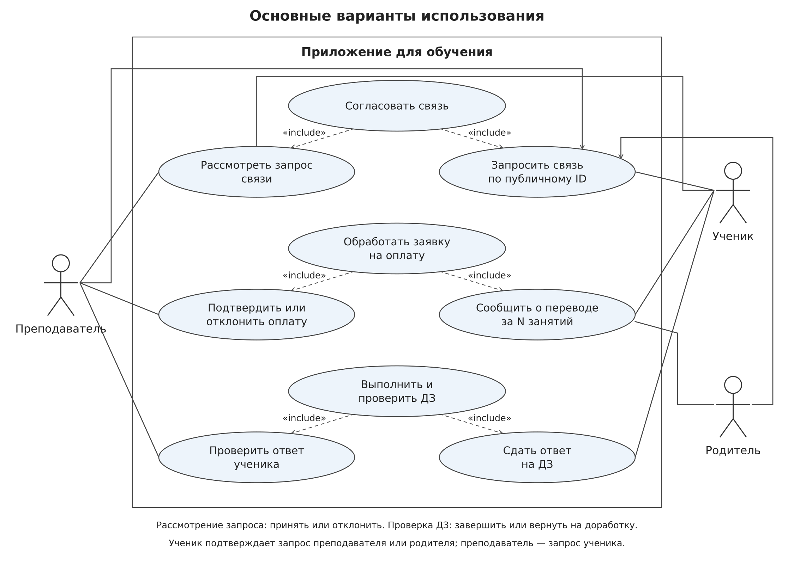

# Приложение для преподавателей и учеников

Учебный проект на Kotlin для ведения расписания, домашних заданий, оценок и учёта оплаченных занятий. Преподаватели и ученики находят друг друга по публичному ID и подтверждают связь. Родители получают доступ к учебным и финансовым данным своих детей, кроме личной обратной связи ребёнка о занятии.

Сервер проектируется как модульный монолит. Первую лабораторную составляет бэкенд с документированным API и тестами. Клиенты для desktop и Android разрабатываются позднее.


## Документация

| Документ | Назначение |
|---|---|
| [Полное техническое задание](docs/requirements/README.md) | Требования ко всему продукту, роли, бизнес-правила и UML |
| [Первая лабораторная](docs/lab1/README.md) | Обязательный объём бэкенда, API и критерии приёмки |
| [Архитектура](docs/architecture.md) | Границы модулей, зависимости и владение данными |
| Диаграмма вариантов использования |  |

## Основные решения

- Много преподавателей, родителей, учеников; один аккаунт может иметь несколько ролей.
- Вход по логину и паролю. Подтверждение email отложено (TODO).
- Учёт оплаты в единицах занятий по паре «ученик — курс»; покупка запускается из приложения через mock-оплату СБП без ручного подтверждения преподавателем. Курс принадлежит одному преподавателю.
- ДЗ поддерживают текст и ссылки. Файловые вложения не входят в первую лабораторную.
- Приложение хранит ссылку на внешний звонок, но не реализует видеосвязь.

## Реализовано

- Запуск Ktor и PostgreSQL через Docker Compose.
- Миграции Liquibase и подключение Exposed через HikariCP.
- Проверка состояния `GET /api/health`.
- Регистрация и вход с ролями, Argon2id-хешированием пароля и серверными Bearer-сессиями.
- Защищённый профиль `GET /api/me` и отзыв текущей сессии через logout.
- Защищённый поиск минимального профиля по точному публичному ID без раскрытия логина.
- Запросы учебных и родительских связей, подтверждение и отклонение адресатом, списки активных связей, прекращение и восстановление с сохранением истории.
- Курсы преподавателя, индивидуальный и групповой формат, персональные цены, участие учеников и группы с историей состава.
- Календарь, разовые и еженедельные занятия, проверка пересечений, переносы, отмены и история посещаемости.
- Mock-платежи за единицы занятий, баланс, долги, списания, прогноз покрытия и компенсирующие корректировки.
- Домашние задания без файлов, черновики и история попыток, проверки, оценки занятий и приватная обратная связь.
- OpenAPI и Swagger UI.

## Технологии

| Область | Решение |
|---|---|
| Сервер | Kotlin/JVM, Ktor |
| Сборка | Gradle Kotlin DSL, Gradle Wrapper |
| Данные | PostgreSQL |
| Миграции | Liquibase |
| API | REST, JSON, kotlinx.serialization, OpenAPI, Swagger UI |
| Тесты | JUnit, kotlin.test, MockK по необходимости, Ktor testApplication, Testcontainers |
| Локальная инфраструктура | Docker Compose |
| Будущие клиенты | Compose Multiplatform для desktop и Android, Ktor Client |


## Запуск и ручная проверка

Для запуска нужны JDK 21 и Docker с Compose. Для приведённых ниже сценариев также нужны `curl` и `jq`. Все блоки выполняются последовательно в одном Bash-сеансе: следующие шаги используют переменные из предыдущих.

### 1. Чистый запуск

Команда `down -v` удаляет локальные данные PostgreSQL. Если данные нужно сохранить, пропустите её.

```bash
docker compose down -v
./gradlew :server:app:buildFatJar
docker compose up --build -d

export BASE_URL=http://localhost:8080
curl --fail-with-body --silent --show-error "$BASE_URL/api/health" | jq
```

Docker не запускает Gradle и не собирает приложение. После изменений Kotlin-кода сначала повторно выполните `./gradlew :server:app:buildFatJar`, затем пересоберите контейнер командой `docker compose up --build -d`.

Ожидаемый результат:

```json
{
  "status": "UP",
  "database": "UP"
}
```

Swagger UI доступен по адресу <http://localhost:8080/swagger>. Если порт `8080` занят, запустите приложение с `APP_PORT=18080` и измените `BASE_URL`.

### 2. Аккаунты и учебная связь

Создадим преподавателя и ученика, выполним вход и сохраним публичные ID и Bearer-токены:

```bash
TEACHER=$(curl --fail-with-body --silent --show-error \
  -X POST "$BASE_URL/api/auth/register" \
  -H 'Content-Type: application/json' \
  -d '{"login":"manual-teacher","displayName":"Manual Teacher","password":"strong-password","roles":["TEACHER"],"billingTimeZone":"Europe/Moscow"}')

STUDENT=$(curl --fail-with-body --silent --show-error \
  -X POST "$BASE_URL/api/auth/register" \
  -H 'Content-Type: application/json' \
  -d '{"login":"manual-student","displayName":"Manual Student","password":"strong-password","roles":["STUDENT"],"billingTimeZone":"Europe/Moscow"}')

TEACHER_ID=$(jq -r '.publicId' <<<"$TEACHER")
STUDENT_ID=$(jq -r '.publicId' <<<"$STUDENT")

TEACHER_TOKEN=$(curl --fail-with-body --silent --show-error \
  -X POST "$BASE_URL/api/auth/login" \
  -H 'Content-Type: application/json' \
  -d '{"login":"manual-teacher","password":"strong-password"}' | jq -r '.accessToken')

STUDENT_TOKEN=$(curl --fail-with-body --silent --show-error \
  -X POST "$BASE_URL/api/auth/login" \
  -H 'Content-Type: application/json' \
  -d '{"login":"manual-student","password":"strong-password"}' | jq -r '.accessToken')

curl --fail-with-body --silent --show-error "$BASE_URL/api/me" \
  -H "Authorization: Bearer $TEACHER_TOKEN" | jq
```

Преподаватель отправляет запрос на учебную связь, ученик принимает его:

```bash
CONNECTION_REQUEST=$(curl --fail-with-body --silent --show-error \
  -X POST "$BASE_URL/api/learning-connections/requests" \
  -H "Authorization: Bearer $TEACHER_TOKEN" \
  -H 'Content-Type: application/json' \
  -d "{\"targetPublicId\":\"$STUDENT_ID\",\"actingAs\":\"TEACHER\"}")

CONNECTION_REQUEST_ID=$(jq -r '.id' <<<"$CONNECTION_REQUEST")

curl --fail-with-body --silent --show-error \
  -X POST "$BASE_URL/api/learning-connections/requests/$CONNECTION_REQUEST_ID/accept" \
  -H "Authorization: Bearer $STUDENT_TOKEN" | jq
```

### 3. Курс, ученик и короткое занятие

Создадим индивидуальный курс, добавим ученика с ценой `100000` минимальных денежных единиц и запланируем минутное занятие. Начало должно находиться в будущем, поэтому команда добавляет одну минуту к текущему времени:

```bash
COURSE=$(curl --fail-with-body --silent --show-error \
  -X POST "$BASE_URL/api/courses" \
  -H "Authorization: Bearer $TEACHER_TOKEN" \
  -H 'Content-Type: application/json' \
  -d '{"title":"Manual Math","subject":"Mathematics","format":"INDIVIDUAL","callLink":"https://meet.example.org/manual"}')

COURSE_ID=$(jq -r '.id' <<<"$COURSE")

curl --fail-with-body --silent --show-error \
  -X POST "$BASE_URL/api/courses/$COURSE_ID/enrollments" \
  -H "Authorization: Bearer $TEACHER_TOKEN" \
  -H 'Content-Type: application/json' \
  -d "{\"studentPublicId\":\"$STUDENT_ID\",\"priceMinor\":100000}" | jq

LESSON_START=$(date -u -d '1 minute' '+%Y-%m-%dT%H:%M:%SZ')

LESSON=$(curl --fail-with-body --silent --show-error \
  -X POST "$BASE_URL/api/lessons" \
  -H "Authorization: Bearer $TEACHER_TOKEN" \
  -H 'Content-Type: application/json' \
  -d "{\"courseId\":\"$COURSE_ID\",\"startsAt\":\"$LESSON_START\",\"durationMinutes\":1,\"participants\":[{\"studentPublicId\":\"$STUDENT_ID\"}]}")

LESSON_ID=$(jq -r '.id' <<<"$LESSON")
```

### 4. Mock-оплата

Создадим платёж на две единицы. До результата он имеет статус `PENDING` и не меняет баланс:

```bash
PAYMENT=$(curl --fail-with-body --silent --show-error \
  -X POST "$BASE_URL/api/payments" \
  -H "Authorization: Bearer $STUDENT_TOKEN" \
  -H 'Content-Type: application/json' \
  -d "{\"courseId\":\"$COURSE_ID\",\"studentPublicId\":\"$STUDENT_ID\",\"units\":2}")

PAYMENT_ID=$(jq -r '.id' <<<"$PAYMENT")
PROVIDER_PAYMENT_ID=$(jq -r '.providerPaymentId' <<<"$PAYMENT")
jq '{id, status, providerName, providerPaymentId, confirmationUrl}' <<<"$PAYMENT"

curl --fail-with-body --silent --show-error \
  "$BASE_URL/api/payments/$PAYMENT_ID" \
  -H "Authorization: Bearer $STUDENT_TOKEN" | jq
```

В Swagger или консоли имитируем успешный ответ платёжного провайдера, затем отдельно читаем состояние платежа:

```bash
curl --fail-with-body --silent --show-error \
  -X POST "$BASE_URL/api/mock-payments/$PROVIDER_PAYMENT_ID/result" \
  -H 'Content-Type: application/json' \
  -d '{"outcome":"SUCCESS"}' | jq

curl --fail-with-body --silent --show-error \
  "$BASE_URL/api/payments/$PAYMENT_ID" \
  -H "Authorization: Bearer $STUDENT_TOKEN" | jq

curl --fail-with-body --silent --show-error \
  "$BASE_URL/api/courses/$COURSE_ID/students/$STUDENT_ID/payment-summary" \
  -H "Authorization: Bearer $STUDENT_TOKEN" | jq
```

Для проверки отказа создайте ещё один платёж и отправьте `{"outcome":"FAILURE"}`. Баланс после такого результата не изменится.

### 5. Домашнее задание и проверка

Преподаватель создаёт задание к занятию. Дедлайн намеренно находится в прошлом, поэтому сдача будет отмечена как поздняя:

```bash
DEADLINE=$(date -u -d '1 hour ago' '+%Y-%m-%dT%H:%M:%SZ')

ASSIGNMENT=$(curl --fail-with-body --silent --show-error \
  -X POST "$BASE_URL/api/assignments" \
  -H "Authorization: Bearer $TEACHER_TOKEN" \
  -H 'Content-Type: application/json' \
  -d "{\"lessonId\":\"$LESSON_ID\",\"text\":\"Solve exercises 1-3\",\"links\":[\"https://example.org/task\"],\"deadline\":\"$DEADLINE\",\"targetStudentPublicIds\":[\"$STUDENT_ID\"]}")

ASSIGNMENT_ID=$(jq -r '.id' <<<"$ASSIGNMENT")

curl --fail-with-body --silent --show-error \
  -X PUT "$BASE_URL/api/assignments/$ASSIGNMENT_ID/submissions/draft" \
  -H "Authorization: Bearer $STUDENT_TOKEN" \
  -H 'Content-Type: application/json' \
  -d '{"text":"My solution","links":["https://example.org/answer"]}' | jq

SUBMISSION=$(curl --fail-with-body --silent --show-error \
  -X POST "$BASE_URL/api/assignments/$ASSIGNMENT_ID/submissions" \
  -H "Authorization: Bearer $STUDENT_TOKEN")

SUBMISSION_ID=$(jq -r '.id' <<<"$SUBMISSION")
jq '{id, status, submittedLate}' <<<"$SUBMISSION"

curl --fail-with-body --silent --show-error \
  -X PUT "$BASE_URL/api/submissions/$SUBMISSION_ID/review" \
  -H "Authorization: Bearer $TEACHER_TOKEN" \
  -H 'Content-Type: application/json' \
  -d '{"decision":"ACCEPTED","comment":"Correct solution","score":9}' | jq

curl --fail-with-body --silent --show-error \
  "$BASE_URL/api/assignments/$ASSIGNMENT_ID/submissions" \
  -H "Authorization: Bearer $STUDENT_TOKEN" | jq
```

### 6. Оценка занятия и приватная обратная связь

Оценка и feedback доступны после завершения занятия. Команды ниже при необходимости ждут оставшееся время, после чего преподаватель выставляет учебную оценку, а ученик отдельно сохраняет настроение, сложность и личный комментарий:

```bash
LESSON_END_EPOCH=$(($(date -u -d "$LESSON_START" '+%s') + 60))
NOW_EPOCH=$(date -u '+%s')
if (( NOW_EPOCH <= LESSON_END_EPOCH )); then
  sleep $((LESSON_END_EPOCH - NOW_EPOCH + 1))
fi

curl --fail-with-body --silent --show-error \
  -X PUT "$BASE_URL/api/lessons/$LESSON_ID/participants/$STUDENT_ID/attendance" \
  -H "Authorization: Bearer $TEACHER_TOKEN" \
  -H 'Content-Type: application/json' \
  -d '{"status":"PRESENT","reason":"Manual smoke test"}' | jq

curl --fail-with-body --silent --show-error \
  -X PUT "$BASE_URL/api/lessons/$LESSON_ID/participants/$STUDENT_ID/assessment" \
  -H "Authorization: Bearer $TEACHER_TOKEN" \
  -H 'Content-Type: application/json' \
  -d '{"score":8,"comment":"Good progress"}' | jq

curl --fail-with-body --silent --show-error \
  -X PUT "$BASE_URL/api/lessons/$LESSON_ID/feedback" \
  -H "Authorization: Bearer $STUDENT_TOKEN" \
  -H 'Content-Type: application/json' \
  -d '{"mood":4,"difficulty":3,"comment":"The pace was comfortable"}' | jq

curl --fail-with-body --silent --show-error \
  "$BASE_URL/api/assessments?courseId=$COURSE_ID&studentPublicId=$STUDENT_ID" \
  -H "Authorization: Bearer $STUDENT_TOKEN" | jq

curl --fail-with-body --silent --show-error \
  "$BASE_URL/api/lessons/$LESSON_ID/feedback" \
  -H "Authorization: Bearer $TEACHER_TOKEN" | jq
```

### 7. Автоматические тесты и остановка

Интеграционные тесты используют Testcontainers и требуют работающий Docker:

```bash
./gradlew clean test :server:app:buildFatJar
```

Остановить приложение с сохранением базы:

```bash
docker compose down
```

Остановить приложение и удалить локальную базу:

```bash
docker compose down -v
```

## Требования

Документ первой лабораторной ссылается на идентификаторы требований и уточняет объём лабораторной, не копируя правила.

UML классов, состояний и последовательности встроены в Markdown.
