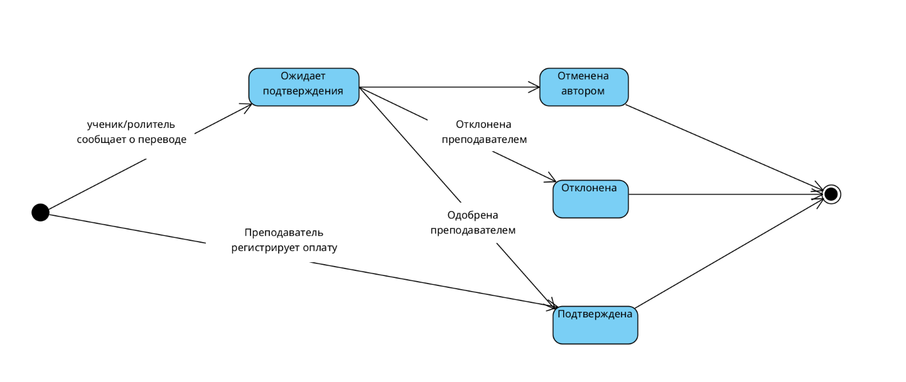
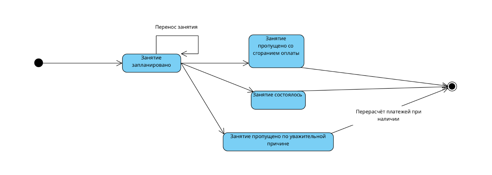
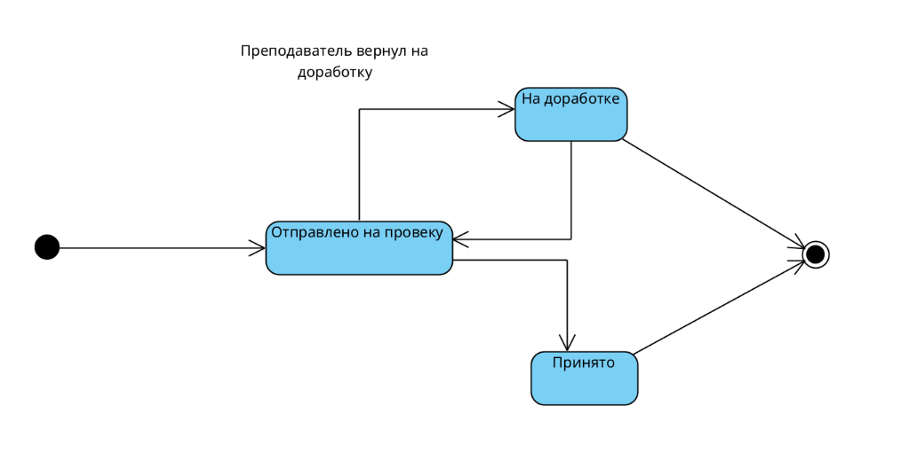
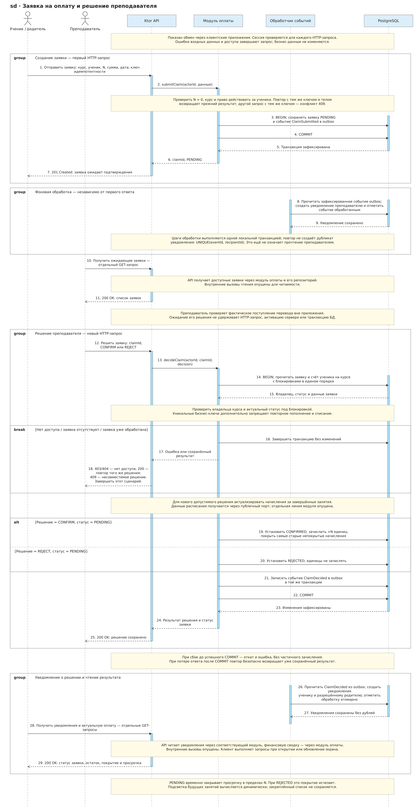

# Техническое задание на приложение для преподавателей и учеников

## 1 Назначение и границы

Приложение помогает преподавателю вести индивидуальные и групповые занятия, выдавать и проверять домашние задания, учитывать оплату и отслеживать результаты обучения. Ученик получает расписание, задания, материалы и сведения об оплате. Родитель контролирует обучение и сообщает об оплате за связанного ребёнка.

В системе работают несколько независимых преподавателей. Ученик может заниматься у нескольких преподавателей и на нескольких курсах. Банковские переводы выполняются вне приложения; система регистрирует сообщения о переводах и подтверждение преподавателем. Приложение не принимает деньги и не проверяет банковское поступление автоматически.

## 2 Термины

| Термин | Определение |
|---|---|
| Аккаунт | Учётная запись с уникальными логином и публичным ID; может иметь несколько ролей |
| Связь обучения | Подтверждённая связь преподавателя и ученика |
| Связь родителя | Подтверждённое учеником разрешение родителю на доступ к его данным |
| Курс | Вид взаимозаменяемых занятий одного преподавателя: предмет, название и формат |
| Участие в курсе | Связь ученика с курсом, его тариф и состояние обучения |
| Группа | Объединение учеников преподавателя;  |
| Серия | Правило еженедельного повторения занятий одного курса |
| Занятие | Конкретное событие календаря с устойчивым ID, временем, курсом и участниками |
| Участник занятия | Персональная запись ученика на занятии: цена, посещение и учебные результаты |
| Единица оплаты | Право на одно платное занятие определённого курса для определённого ученика |
| Заявка на оплату | Сообщение ученика или родителя о переводе за N занятий курса |
| Остаток | Число подтверждённых и ещё не использованных единиц оплаты |
| Начисление | Обязанность оплатить одно состоявшееся или прогулянное занятие |
| Списание | Использование одной подтверждённой единицы для покрытия начисления |
| Просрочка | Вычисляемый признак непокрытого платного занятия с датой раньше сегодняшней |

Индивидуальные занятия и групповые занятия с невзаимозаменяемыми условиями относятся к разным курсам, даже если предмет совпадает. Одна единица не переносится между учениками, преподавателями или курсами.

## 3 Роли и доступ

| Действие | Преподаватель курса | Ученик | Связанный родитель |
|---|---|---|---|
| Смотреть расписание и ссылку на урок | Своих курсов | Своё | Ребёнка |
| Создавать и менять занятия, цены и посещение | Да | Нет | Нет |
| Смотреть остаток, заявки и историю оплат | Своих учеников | Свои | Ребёнка |
| Сообщить о переводе | Может сразу зарегистрировать оплату | За себя | За ребёнка |
| Подтвердить или отклонить заявку | Да | Нет | Нет |
| Создать ДЗ и проверить ответ | Да | Нет | Нет |
| Смотреть ДЗ, ответ, комментарий проверки и оценку | Своих учеников | Свои | Ребёнка |
| Сдать ДЗ | Нет | За себя | Нет |
| Смотреть материалы | Свои и выданные им доступы | Разрешённые | Доступные ребёнку |
| Заполнить настроение, сложность и личный комментарий | Нет | За себя | Нет |
| Читать личную обратную связь ученика | Только своих занятий | Только свою | Нет |
| Смотреть персональные данные других участников группы | В пределах своего преподавания | Нет | Нет |

### UML вариантов использования

[use-cases.png](../diagrams/use-cases-visual-paradigm.png). 

## 4 Функциональные требования

### 4.1 Аккаунты и связи

| ID | Требование |
|---|---|
| AUTH-01 | Регистрация по уникальному логину и паролю; вход, выход и получение своего профиля |
| AUTH-02 | Поддержка ролей преподавателя, ученика и родителя; несколько ролей в одном аккаунте |
| AUTH-03 | Поиск точным публичным ID возвращает минимальный профиль; не раскрывает учебные и финансовые данные |
| AUTH-04 | Проверка доступа на сервере для каждого чтения и изменения; пароль хранится только как стойкий хеш |
| REL-01 | Преподаватель или ученик отправляет запрос на связь; второй участник подтверждает или отклоняет |
| REL-02 | Родитель отправляет запрос по ID ребёнка; ученик подтверждает; родитель не получает пароль ребёнка |
| REL-03 | Участник может прекратить свою связь; новые запросы доступа по прекращённой связи запрещены; история не удаляется |
| REL-04 | При прекращении связи преподаватель сохраняет собственную историю занятий и оплат; ученик — свою. Доступ родителя после отзыва прекращается ко всем данным ребёнка |

Группы и курсы создаются преподавателем. Включение ученика требует действующей связи обучения. Восстановление связи не создаёт второй баланс для той же пары ученика и курса.

### 4.2 Курсы и группы

| ID | Требование |
|---|---|
| CRS-01 | Курс имеет владельца, название, предмет и формат. Единицы оплаты учитываются по ученику и курсу |
| CRS-02 | Поддерживаются индивидуальные и групповые занятия; серии и разовые занятия курса используют один остаток |
| CRS-03 | Преподаватель задаёт персональные цены; одинаковая цена массово заполняет цены участников |
| CRS-04 | Изменение цены применяется к новым покупкам; уже подтверждённые единицы не требуют доплаты |
| GRP-01 | Создание группы, изменение названия и состава; изменение состава применяется к будущим занятиям, прошедшие записи сохраняются |
| GRP-02 | Ученику и родителю доступны расписание, задания, материалы и объявления своей группы; чужие оценки, ответы, платежи и отзывы закрыты |

### 4.3 Расписание

| ID | Требование |
|---|---|
| SCH-01 | Календарь по диапазону дат, преподавателю, ученику и курсу с учётом доступа |
| SCH-02 | Создание разового занятия: курс, начало, длительность, участники и персональные цены |
| SCH-03 | Еженедельные серии по выбранным дням недели; преподаватель задаёт период действия серии |
| SCH-04 | Изменение времени или дня только выбранного занятия либо выбранного и последующих занятий серии |
| SCH-05 | При разовом переносе ID занятия сохраняется; изменение серии не меняет проведённую историю |
| SCH-06 | Отмена одного или выбранного и последующих будущих занятий с уведомлением участников |
| SCH-07 | Запрет пересечений у преподавателя и учеников. Интервалы полуоткрытые: конец одного может совпадать с началом другого |
| SCH-08 | Дата и время отображаются в часовом поясе пользователя; зона преподавателя используется для определения финансовой просрочки |
| SCH-09 | Карточка содержит время, длительность, курс, участников в разрешённом объёме, цену, оплату, посещение, ссылку, ДЗ, оценки и доступную обратную связь |
| SCH-10 | Посещение отмечается персонально: присутствовал, уважительный пропуск, прогул. До отметки состояние неизвестно |
| SCH-11 | После окончания занятия оно подлежит оплате, если не отменено и участнику не поставлен уважительный пропуск; неизвестная посещаемость не блокирует учёт долга |

Время конкретного занятия хранится как момент времени; серия хранит локальное время и зону. Для лабораторной серия конечна: будущие события создаются до заданной даты окончания.

Исправление посещаемости задним числом должно корректировать оплату с сохранением истории. 

### 4.4 Оплата в единицах занятий

| ID | Требование |
|---|---|
| PAY-01 | Показ подтверждённого остатка, количества на проверке и непокрытых прошедших занятий по ученику и курсу |
| PAY-02 | Создание заявки: курс, ученик, положительное целое N, сумма и дата фактического перевода, необязательный комментарий |
| PAY-03 | До отправки показ динамического прогноза: старые долги и ближайшие занятия, которые покрывает заявка. Список будущих распределений не сохраняется |
| PAY-04 | Оплата одного занятия использует тот же сценарий с N = 1; старые долги имеют приоритет, выбор карточки не закрепляет оплату за ней |
| PAY-05 | Ученик или родитель создаёт заявку; только преподаватель курса подтверждает или отклоняет её |
| PAY-06 | Преподаватель может зарегистрировать подтверждённую оплату без предварительной заявки ученика, с сохранением автора и причины |
| PAY-07 | Подтверждение добавляет N единиц ровно один раз; отклонение не добавляет единиц |
| PAY-08 | Сначала покрываются самые старые непокрытые начисления этого курса, затем остаток покрывает будущие занятия |
| PAY-09 | Присутствие и прогул расходуют одну единицу; уважительный пропуск и отмена не расходуют единиц и не создают долг |
| PAY-10 | При отсутствии единицы платное прошедшее занятие остаётся непокрытым; подтверждённый остаток не становится отрицательным |
| PAY-11 | Подтверждённые свободные единицы динамически покрывают ближайшие подходящие будущие занятия; расписание не ограничивает возможность купить N единиц |
| PAY-12 | Единицы на проверке динамически покрывают ещё не покрытые занятия, начиная со старых долгов; они не дублируют покрытие подтверждёнными единицами |
| PAY-13 | Занятие с неподтверждённым покрытием показывает «Ожидает подтверждения» и не показывает просрочку. После отклонения покрытие исчезает |
| PAY-14 | История пополнений, списаний и корректировок неизменяема; исправление выполняется компенсирующей записью |
| PAY-15 | Повторные и конкурентные запросы не создают двойного пополнения, списания или покрытия одного начисления |

Ошибочную заявку можно отменить автором до решения преподавателя; после отклонения или отмены создаётся новая. Подтверждённую запись нельзя молча отредактировать или удалить.

#### Порядок расчёта

1. Учесть завершившиеся платные занятия и исправления посещаемости, не создавая дубликаты начислений.
2. Свободными подтверждёнными единицами покрыть старые непокрытые начисления по времени начала, при равенстве — по ID занятия.
3. Остатком подтверждённых единиц покрыть прогноз ближайших запланированных занятий того же курса и ученика.
4. Суммарным количеством единиц действующих заявок на проверке покрыть оставшиеся начисления и будущие занятия в том же порядке.
5. Для каждого непокрытого платного занятия с локальной датой раньше текущей даты преподавателя показать просрочку.

Оплаченные будущие занятия могут меняться при переносах и добавлении событий. При остатке 2 перенос занятия 5 октября на 26 октября может сделать покрытыми занятия 12 и 19 октября. Это ожидаемое поведение.

Если отмена или уважительная причина внесены после списания, система возвращает единицу компенсирующей записью и снова применяет приоритет старых долгов. При обратном исправлении создаётся или восстанавливается обязанность оплаты. Исторические списания остальных занятий без причины не переставляются.

#### Примеры приёмки расчёта

| Условие | Результат |
|---|---|
| Подтверждено 10 единиц, будущего расписания нет | Остаток 10, пустой календарь, потери единиц нет |
| Два долга, заявка на 5 единиц на проверке | Два занятия ожидают подтверждения без просрочки, три будущих предварительно покрыты |
| Та же заявка подтверждена | Два исторических списания, остаток 3 |
| Заявка на 1 единицу при двух долгах | Только самый старый долг ожидает подтверждения, второй остаётся просроченным |
| Заявка отклонена | Её временное покрытие исчезает; непокрытые старые занятия снова просрочены |
| Уважительный пропуск при остатке 3 | Списания нет; три следующих подходящих занятия покрыты |
| Прогул при остатке 0 | Возникает непокрытое начисление; со следующего локального дня — просрочка |
| Повторное подтверждение одной заявки | Итоговый прирост остаётся N, а не 2N |

### 4.5 Домашние задания и вложения

| ID | Требование |
|---|---|
| HW-01 | Преподаватель создаёт задание к занятию для одного или нескольких участников: текст, ссылки, вложения и необязательный дедлайн |
| HW-02 | Ученик видит свои задания, сохраняет и сдаёт текст и/или файлы |
| HW-03 | Преподаватель оставляет комментарий, оценку 0–10, возвращает на доработку либо завершает проверку |
| HW-04 | Повторная сдача создаёт новую попытку; предыдущий ответ и вложения остаются в истории |
| HW-05 | Родитель читает задания, ответы и результаты ребёнка, но не сдаёт и не редактирует работу за него |
| HW-06 | Просрочка ДЗ вычисляется отдельно от состояния сдачи; поздняя сдача разрешена и отмечается |
| FILE-01 | Для заданий и ответов поддерживаются JPEG, PNG и PDF; начальные лимиты — 2 файла по 5 МБ на задание или попытку |
| FILE-02 | Проверка размера фактического потока, допустимого типа и содержимого, прав загрузки, привязки и скачивания |
| FILE-03 | Файлы имеют серверный ключ хранения; оригинальное имя — метаданные. Неиспользованные и незавершённые загрузки очищаются |
| FILE-04 | Хранилище подключается через интерфейс; первая версия использует локальную директорию или volume |

Ответ после сдачи неизменяем; редактировать можно черновик и новую попытку после возврата на доработку. Для группы задание общее, попытки и проверки персональные.

### 4.6 Оценки и обратная связь

| ID | Требование |
|---|---|
| ASMT-01 | Преподаватель выставляет персональную оценку занятия от 0 до 10 и комментарий; история и среднее доступны ученику и родителю |
| ASMT-02 | В дальнейшем — настраиваемые критерии с итогом 0–10. Шкалы версионируются, старые оценки сохраняют исходный смысл |
| FB-01 | После окончания занятия ученик добровольно задаёт настроение и сложность по независимым шкалам 1–5 |
| FB-02 | Настроение: 1 — очень плохое, 5 — отличное; сложность: 1 — очень легко, 5 — очень сложно |
| FB-03 | Личный комментарий необязателен |
| FB-04 | Обратную связь читает только её автор и преподаватель занятия; родитель и другие участники её не получают |
| FB-05 | В дальнейшем — отдельная динамика настроения и сложности для ученика и преподавателя; общий средний балл между этими шкалами не вычисляется |

### 4.7 Уведомления и видеосвязь

| ID | Требование |
|---|---|
| NOT-01 | Внутренний список уведомлений: приглашения, переносы и отмены, новое ДЗ, сдача, проверка, создание заявки и решение по оплате |
| NOT-02 | Прочитанное состояние принадлежит получателю; сообщения не раскрывают чужие персональные данные |
| NOT-03 | Событие уведомления надёжно сохраняется вместе с бизнес-изменением; повторная обработка не создаёт дубликаты внутренних уведомлений |
| NOT-04 | В дальнейшем — напоминания о занятиях за 5, 15, 30 минут, 1 час или 1 день; о дедлайнах и необходимости оплаты |
| NOT-05 | В дальнейшем — Android push и Telegram при подключённой интеграции и настройках получателя |
| VID-01 | Постоянная ссылка на внешний сервис видеосвязи для курса или группы; возможна ссылка конкретного занятия |
| VID-02 | Клиент показывает кнопку подключения; приложение не реализует собственную видеоконференцию |

Внутреннее уведомление хранится на сервере и доступно при обращении клиента. Оно не означает доставку системного уведомления при закрытом приложении.

### 4.8 Материалы, рассылки и клиенты

| ID | Требование |
|---|---|
| UI-01 | Desktop- и Android-клиенты на Kotlin; один продукт с доступными по роли действиями |
| UI-02 | Главная: ближайшее занятие и подключение, расписание, незавершённые ДЗ, остаток и заявки по курсам, уведомления и новые материалы |
| UI-03 | Отображение истории занятий, оценок и оплат; приватная обратная связь отсутствует в интерфейсе родителя |
| ANA-01 | Графики учебных оценок за период; личные настроение и сложность отображаются отдельно с соблюдением FB-04 |

### Уточнения
Обязанность оплаты учитывается после окончания занятия даже до ручной отметки посещения; ожидающую заявку можно отменить её автором; поздняя сдача ДЗ разрешена; прекращение связи не стирает историю сторон. 

## 5 UML состояний

### Заявка на оплату

Прямой переход при ручной регистрации всё равно сохраняет автора и запись о пополнении. 

### Занятие и посещение

Завершение по времени не означает подтверждение фактического присутствия. Посещение каждого ученика хранится независимо: `UNKNOWN`, `PRESENT`, `EXCUSED_ABSENCE`, `UNEXCUSED_ABSENCE`. Изменение посещения после завершения запускает корректировку начисления по SCH-11 и PAY-09.

### Работа ученика над ДЗ

## 6 UML подтверждения оплаты

## 7 Нефункциональные требования

| ID | Требование и проверка |
|---|---|
| NFR-01 | Пароли не хранятся и не журналируются в открытом виде; секреты поступают через окружение; проверяются права каждого объекта |
| NFR-02 | Подтверждение заявки и изменение единиц атомарны; конкурентные запросы не нарушают PAY-15 |
| NFR-03 | Уведомления переживают перезапуск; повтор обработки не создаёт дубликат внутреннего сообщения |
| NFR-04 | Схема создаётся и обновляется Liquibase. |
| NFR-05 | Серверные часы подменяемы в тестах; финансовые решения не зависят от часов клиента |
| NFR-06 | Значимые изменения оплат, посещения и доступа содержат автора, время и причину; личные отзывы не попадают в общие логи |

